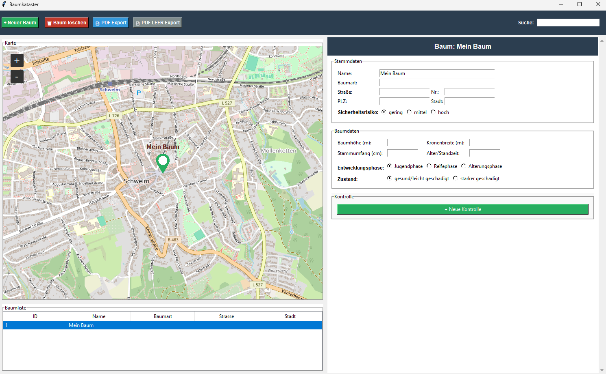

# Baumkataster

Ein Desktop-basiertes Management-Tool für den Garten- und Landschaftsbau zur digitalen Erfassung und Verwaltung von Baumbeständen inklusive geografischer Kartierung und automatisierter PDF-Protokollerstellung.

## Features

* **Interaktive Kartenansicht:** Visualisierung der Bäume via `tkintermapview` (OpenStreetMap).
* **Geocoding:** Automatische Ermittlung von Koordinaten basierend auf der Adresse.
* **Blanko-Export:** Generierung leerer Begehungsprotokolle für die Arbeit vor Ort.
* **Risiko-Management:** Farblich kodierte Marker (Grün, Gelb, Rot) je nach Sicherheitszustand des Baumes.
* **Historisierung:** Speicherung beliebig vieler Kontrollgänge pro Baum in einer lokalen SQLite-Datenbank.

---

## Download Exe (Windows)

Windows: 

1. Klick rechts auf dieser Seite auf **[Releases](https://github.com/AdamSalato/Baumkataster/releases)**.
2. Lade dir dort unter "Assets" die Datei `Baumkataster.exe` herunter.
3. Starte die Datei einfach per Doppelklick.
   * **Hinweis:** Da die App (noch) nicht offiziell signiert ist, zeigt Windows beim ersten Start eventuell einen blauen Warnhinweis. Klick einfach auf **"Weitere Informationen"** und dann auf **"Trotzdem ausführen"**.
---

## Nutzungshinweis

* Beim ersten Start wird automatisch eine Datenbankdatei im selben Verzeichnis angelegt.
* **Rechtsklick** auf die Karte, um einen neuen Baum hinzuzufügen oder über Button "+ neuer Baum"."
* Änderungen auf der Detailseite eines Baumes werden automatisch gespeichert.
* Kontrollprotokolle könenn jederzeit erstellt werden. Über Dropdown-Menü können Kontrollprotokolle aufgerufen werden.
* PDF Export erzeugt eine PDF des gewählten Baums und Kontrollprotokolls
* PDF LEER EXPORT erzeugt ein leeres Kontrollprotokoll.

