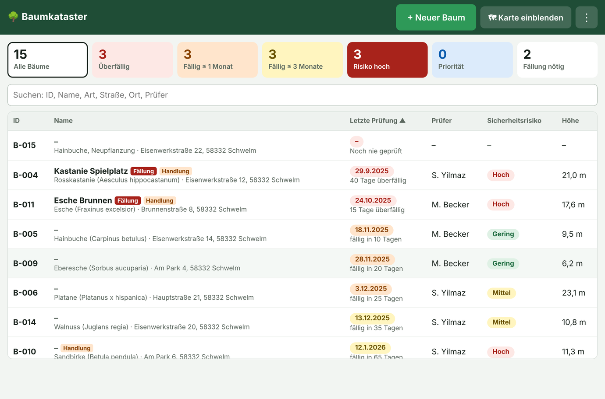
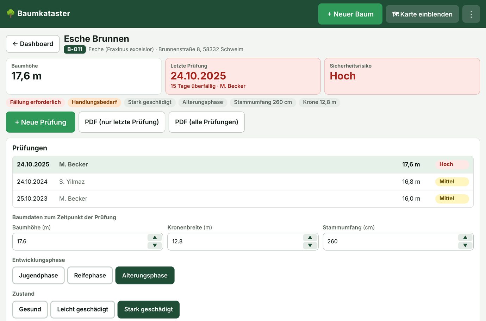

# 🌳 Baumkataster

Webanwendung für Baumkontrollen im GaLaBau: Bäume auf der Karte erfassen, Prüfungen dokumentieren, fällige Kontrollen auf einen Blick sehen und Protokolle als PDF ausgeben.

**Aufruf:** https://adamsalato.github.io/Baumkataster/

## Funktionen

- Dashboard mit Karte und Baumliste, dringende Bäume stehen oben
- Ampel nach Prüfintervall: überfällig (rot), ≤ 30 Tage (orange), ≤ 3 Monate (gelb)
- Automatische Baum-IDs (B-001, B-002, …)
- Neue Prüfung übernimmt die Werte der letzten Prüfung
- Regelkontrolle mit Checkliste und Prüfhistorie
- PDF-Export (letzte Prüfung, alle Prüfungen oder eine einzelne Prüfung)
- Für Tablet und Handy geeignet, die Karte lässt sich ausblenden

## Dateien

| Datei | Zweck |
|---|---|
| `index.html` | Die Anwendung |
| `setup.sql` | Einrichtung der Datenbank in Supabase |
| `test.html` | Testversion ohne Datenbank (Login `admin` / `admin`, Daten nur im Browser) |

## Einrichtung

1. Bei [Supabase](https://supabase.com) ein kostenloses Projekt anlegen.
2. Im SQL Editor den Inhalt von `setup.sql` ausführen.
3. Unter Authentication → Users die Benutzer anlegen und die freie Registrierung abschalten.
4. In `index.html` `SUPABASE_URL` und `SUPABASE_KEY` (anon key) eintragen.
5. GitHub Pages aktivieren: Settings → Pages → Branch `master`, Ordner `/ (root)`.

## Alte Desktop-Version

Die frühere Python-Anwendung ist unter [Releases](../../releases) weiterhin verfügbar.
